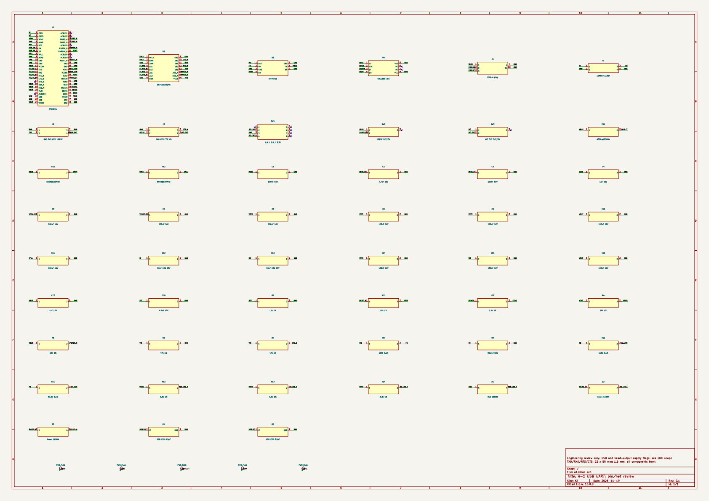
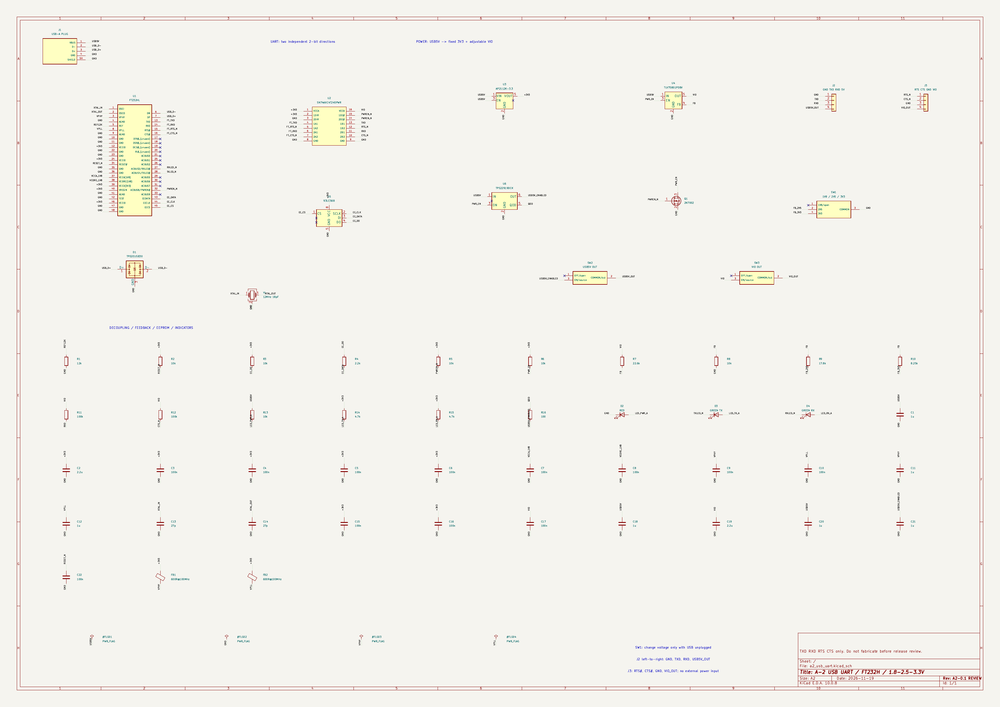
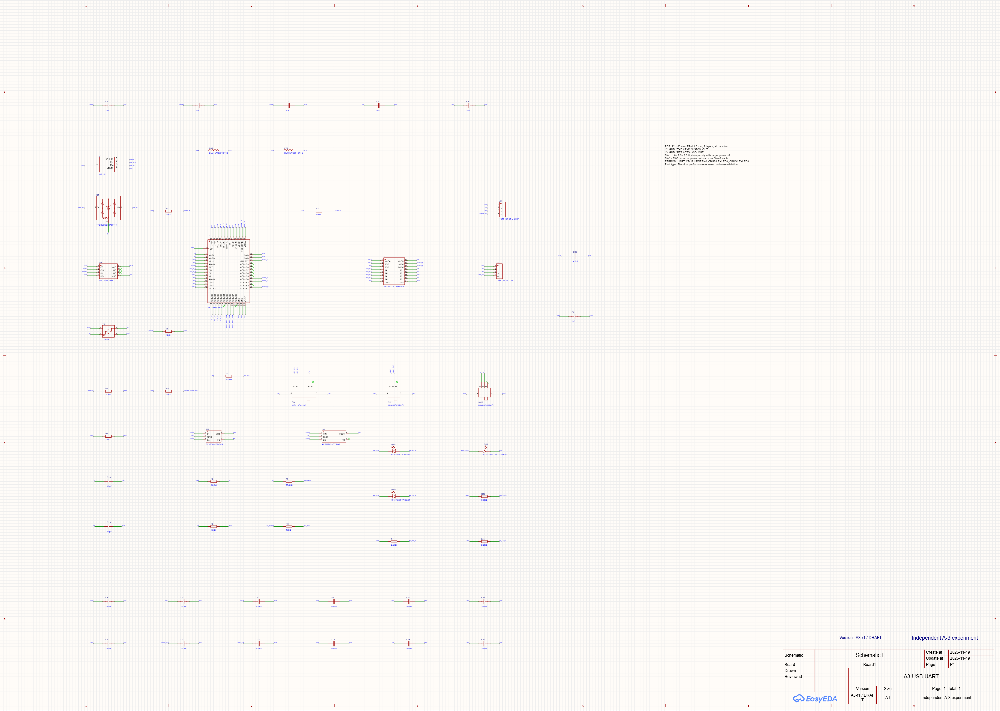
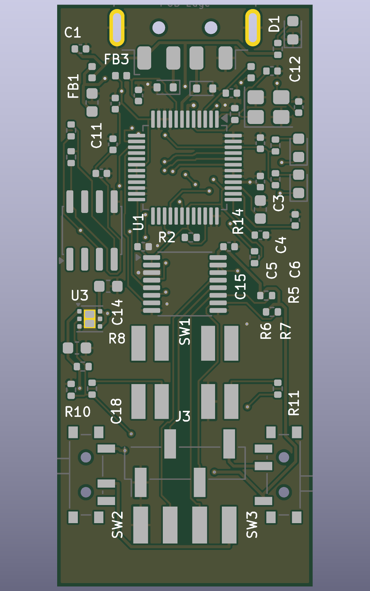
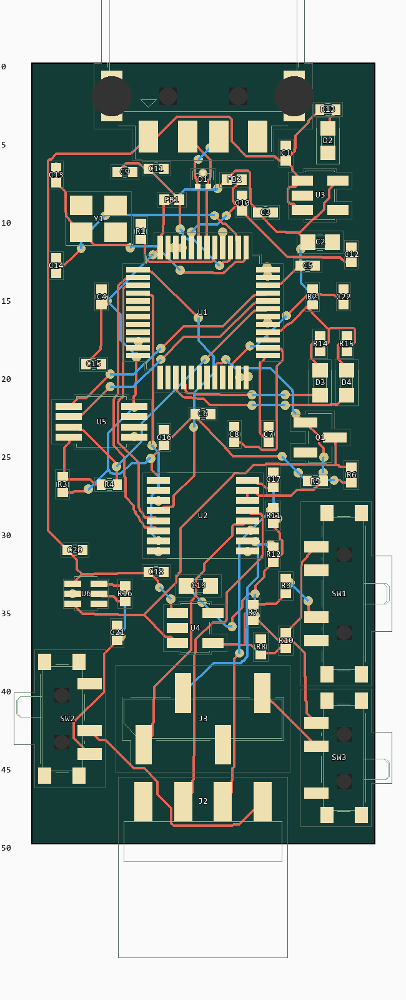
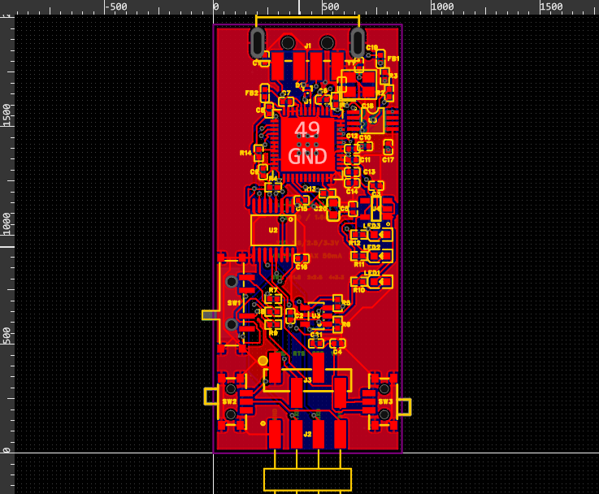

# A-1 / A-2 / A-3 初回設計結果の一次チェック

記録日: 2026-11-19 JST

## 評価範囲

mainに統合済みの3方式の成果物（元の実験ブランチにも保存）、各方式の`reports/result.md` / `design_review.md`、ERC・DRC・接続検証JSON、BOMや製造データの存在、作業ログを**リモートで確認**した。ここではローカルCADでの再読込や実データの独立DRC・独立CAM・実機試験は行っていない。

| 項目 | A-1 atopile+KiCad | A-2 KiCad | A-3 EasyEDA Pro |
| --- | --- | --- | --- |
| 設計成果物 | `experiment/A-1` | `experiment/A-2` | `experiment/A-3` |
| 作業ログ基準所要 | 約49分 | 約36分 | 約84分 |
| 基板 | 22×50 mm・2層・1.6 mm | 22×50 mm・2層・1.6 mm | 22×50 mm・2層・1.6 mm |
| 部品数・搭載面 | 51 / 全数表面 | 58 / 全数表面 | 53 / 全数表面 |
| ERC | 0件（KiCad） | 0件（KiCad） | 合格・詳細0件（EasyEDA） |
| DRC・未配線 | 0件・0 | 0件・0 | 合格・詳細0件・0 |
| 接続照合 | 174接続指定・差分0 | 207端子・差分0 | 185接続ピン・差分0 |
| 編集用設計 | atopile .ato、KiCad sch/pcb | KiCad sch/pcb | EasyEDA .eprj3 と sch/pcb |
| 製造出力 | Gerber/ドリル/BOM/座標 | Gerber/ドリル/BOM/座標 | Gerber/ドリル/BOM/座標 |
| 製造承認・実機評価 | なし | なし | なし |

接続照合の件数は各手段で**計数対象が違う**ため、そのまま品質の優劣とはみなさない。ERC/DRCも各CADの規則・設定範囲が異なる。

## 画像で比較する回路図・基板図（人間レビュー前）

**同じUSB-UART要求仕様**から3つのCodexセッションが独立に生成した成果物を、保存済みプレビュー画像で横並び比較する。画像をクリックするとGitHub上の元画像を開ける。実際のCADを再実行して描き直した画像ではない。

### 回路図：全体の見え方

| A-1：atopile + KiCad | A-2：KiCad直接設計 | A-3：EasyEDA Pro |
| :---: | :---: | :---: |
|  |  |  |
| [PDF（ベクター図）](../01_New_Design/atopile/reports/schematic.pdf) / [KiCad回路図](../01_New_Design/atopile/board/a1.kicad_sch) | [PDF（ベクター図）](../01_New_Design/kicad_direct/reports/schematic.pdf) / [KiCad回路図](../01_New_Design/kicad_direct/a2_usb_uart.kicad_sch) | [元画像を拡大](../01_New_Design/easyeda/reports/A3-schematic.png) / [EasyEDA工程](../01_New_Design/easyeda/projects/A3-USB-UART/A3-USB-UART.eprj3) |

**図面の読みやすさ（一次観察）**：A-1は独自の矩形シンボルが中心で、部品とピン・ネットの照合には使えるが、機能単位の信号の流れを読み取るには工夫が必要。A-2は一般的な抵抗・コンデンサ・ICのシンボルを使用しており、設計者が回路の機能を追いやすい。A-3はEasyEDA固有の回路図表示であり、クリックして元画像を確認した後に人間が配線ラベル・機能ブロック・可読性を正式判定する。**ここでの評価はプレビューの形式・構成に限り、電気的な正しさを意味しない。**

### PCB：最終配線・配置の見え方

| A-1：atopile + KiCad | A-2：KiCad直接設計 | A-3：EasyEDA Pro |
| :---: | :---: | :---: |
|  |  |  |
| [表面配線SVG](../01_New_Design/atopile/reports/board-front.svg) / [裏面配線SVG](../01_New_Design/atopile/reports/board-back.svg) | [各層PDF](../01_New_Design/kicad_direct/reports/pcb_layers.pdf) / [KiCad PCB](../01_New_Design/kicad_direct/a2_usb_uart.kicad_pcb) | [実配線プレビュー](../01_New_Design/easyeda/reports/pcb-routed.png) / [EasyEDA PCB](../01_New_Design/easyeda/projects/A3-USB-UART/pcb/PCB1.epcb2) |

**表示条件の注意**：A-1はKiCad系の裸基板トップ画像（銅箔・パッドの表示）、A-2は表裏配線を色分けした独自プレビュー、A-3はEasyEDAエディタ画面のスクリーンショットで、銅箔・配線・ベタの描画条件が異なる。**画像は同一縮尺・同一レイヤー・同一色調ではない**ため、見た目の赤色の量、線の密度、基板画像上の占有率だけで配線品質やGND面の良否を判断しない。拡大確認には各CADファイル、層別PDF/SVGを使用する。

### 図面と対応づけた方式ごとの違い

| 観点 | A-1 atopile + KiCad | A-2 KiCad直接 | A-3 EasyEDA Pro |
| --- | --- | --- | --- |
| 回路構成の正本・生成 | `.ato`と部品マニフェストから生成。KiCad回路図は接続照合用として別途作成 | KiCadネイティブ回路図・PCBをPythonで生成・編集 | EasyEDAネイティブ回路図・PCBを公式CLI/APIで編集 |
| FT232Hパッケージ | FT232HL（LQFP系） | FT232HL（LQFP系） | FT232HQ（QFN系） |
| 部品数 | 51 | 58 | 53 |
| 配線の完了方法 | FreeroutingのSES取込み後、Pythonで未接続やGNDを補修 | Python/pcbnewの探索・補修処理 | EasyEDA内蔵ルータの途中候補をAPIで採用し、Python経路計算で補修 |
| ERC・DRC・未配線 | KiCad ERC/DRC 0、未配線0。ただしatopile型付きERCは未検証 | KiCad ERC/DRC 0、未配線0 | EasyEDA ERC/DRC合格、未配線0 |
| 回路図のレビュー性 | 矩形シンボル中心、接続表との突合向け | 一般的な回路記号中心 | EasyEDA固有の画面構成、正式レビュー待ち |

**比較上の注意**：A-3のFT232HQはA-1/A-2のFT232HLとパッケージが異なる。基板上の密度、配線本数、ビア数、部品数、設計時間の差はCADツールの能力だけによるものではない。図面を等価な部品条件に揃えて再比較した結果ではない。

### 画像から先に確認したい設計レビュー項目

1. **USB 2.0 High-Speed**：3方式とも90 Ω差動インピーダンス、GND帰路、スキューを未検証。A-1はD−に2ビア、A-2はD+に2ビア、A-3はD+に層変更あり。異層遷移と非対称性を拡大して確認する。
2. **発振回路**：特にA-1のXOは枝を含め約25.6 mmかつ2ビア。水晶と負荷容量の配置、発振線の寄生・GNDとの結合を確認する。
3. **実装可能性**：A-1は4か所のvia-in-pad候補、A-2はヘッダの暫定ランド、A-3はQFN露出パッド周辺のビア・ペースト条件。CADのDRC合格だけで判断しない。
4. **電源・機能**：VIO切替抵抗、IOレベル変換方向、USB電流予算、外部電源出力スイッチ、EEPROM/ACBUS設定を個別のメーカー資料と照合する。
5. **人間による編集・修正容易性**：回路図の可読性、局所配線変更のしやすさ、AIが生成したスクリプトを再実行したときの破壊的変更リスクを比較する。

**状態：ユーザーレビュー前の資料。** 既存の回路・PCB・製造データや評価JSONを変更せず、保存済み画像を参照して並列表示したもの。ローカルCADによる再DRC・独立Gerber CAM・実機測定・製造発注は実施していない。

## 3方式に共通する条件と未解決事項

- 入力仕様のスナップショットは同じSHA256 `ac9853c17769796ff49d9df7332f76452fc38abaa7928b77d9b8bf093d6f8dbe`。3方式とも途中のユーザー指示による**UART 4信号（TXD/RXD/RTS/CTS）への限定、板厚1.6 mmへの変更**を記録。
- USB差動90Ω、実際のGNDリターンパス、USB HS信号品質、発振、水晶、電源とスイッチの動作、EEPROM設定、実機6Mbps、熱・EMCなどは評価未完了。
- 部品選定も完全には同等でない。A-1/A-2ではFT232HL-REEL、A-3ではFT232HQ-REEL。採用LDO、部品数、外部負荷定格にも違いがある。単純な部品数・所要時間の差をCAD単独の優劣と結び付けない。
- 独自フットプリント、正式ランド、実装・調達・製造業者の承認、独立CAMでのGerber検証はまだ必要。
- 3方式の完了報告は**製造前レビュー版に到達**したという意味。製造発注できる水準の承認ではない。

## A-1 固有の観察

- atopile 0.15.8の隔離修復版でビルド成功。ただし部品は型番を手動選定し、atopileの自動部品選定や有効な型付き電源ERCまでは実証されていない。
- FreeroutingのSES取り込み後に未配線等が残り、KiCad/Pythonで追加補修してDRCに合格。
- XOが約25.6mmで2ビア、ビア・パッド重複4か所、USB D−側のビアなど、レイアウトのレビュー項目が残る。
- 人間が読めるKiCad回路図はあるが、独自矩形シンボル中心で回路図としての視認性を評価する必要がある。

## A-2 固有の観察

- KiCad 10.0.8の回路図・PCBデータと、自己実装のPython生成/経路探索/補修処理で完走。
- USB D+に2ビア、D−に0ビア。90Ω差動配線と正式なヘッダランドの照合が残る。
- `reports/drc_final.json`と`reports/erc_final.json`の違反0件、`verification.json`の接続不一致0件を確認。

## A-3 固有の観察

- EasyEDA Pro 4.1.105のCLI/APIを利用。初回ローカル工程作成はユーザーから依頼したGUI操作が必要だった。
- 内蔵自動配線は完走せず、途中候補を公式APIで反映し、Python/NumPyによる局所補修後にDRC合格。
- `drc-final.json`は`passed:true`、違反なし、ラッツネスト0。ERCも`passed:true`。回路図・PCB各185接続ピン一致。
- `save-reload-verification.json`は再読込後の部品・配線・ビア・ゾーン・積層・ルール・ネットリストの一致を示す。初回保存と再読込では正規化が必要な数値表現差があったが、再保存後は安定している。
- BOMは27種類・合計53部品、実装座標53部品、Gerber ZIPのCRC・必要層・ドリルの存在を自動照合。
- USB D+に層変更あり。差動インピーダンス、露出パッドの実装条件、外部電源出力の自動保護などは未検証。

## 所要時間の扱い

3方式の所要時間は`docs/experiment_elapsed_time.md`参照。作業ログの開始/終了時刻に基づく概算であり、UI操作・追加指示・試行錯誤・レポート作成も含む。並列実行全体の経過は約84分。A-3のログ22:44と最終Gitコミット22:41:52に数分差がある。

## 次工程

3方式は2026-11-19に`main`へ統合済みで、元の`experiment/A-1`・`experiment/A-2`・`experiment/A-3`ブランチにも生成直後の成果物が残っている。詳細は[統合レポート](design_integration_report.md)を参照。まず本書の回路図とPCB画像を比較し、CADファイルを開いて重要配線・部品選定・電気特性・実装性を人間がレビューする。修正は生成直後の成果物を保持したうえで別コミットまたは別ブランチに記録する。**本書を追加した時点では人間による設計承認は行っていない。**
