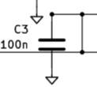
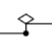

# 回路設計のOK判定と作図指摘の受付

日時: 2026-11-22 20:11 JST。対象は`codex/a2-review-capacitors`、`886ad5428d4be98768ccc8bb942aa2f54f23d942`。直前に提示した修正版への判定・指摘として記録する。

## 判定とレビューの段階

「R-0007/0008共にOK」に基づき、両件を完了・OKとした。判定者はユーザー。R-0001〜R-0006の既存判定と、R-0007/R-0008の調査・対応履歴を維持した。

ユーザーは「回路設計の指摘は以上」「引き続き回路図の作図についての指摘を行う」と述べた。以下の5件を対象工程「回路図」で登録した。指摘収集モードを継続し、今回その場で詳細調査・修正・電気的検証は行っていない。回路設計項目のOK判定は、実機検証・PCB/BOM更新・製造承認の完了を意味しない。

## 新規指摘

| ID | 対象 | 指摘要旨 |
| --- | --- | --- |
| R-0009 | C3、U1.12、+3V3 | C3は電源シンボル→C3の分岐点→入力ピンの電源経路からGNDへ縦配置する。現状のL字接続を改善し、+3V3シンボルは24番ピン用と分けてもよい。 |
| R-0010 | USB5Vのパスコンと入力ピン周辺 | USB5VもC3と同様に、電源シンボル→コンデンサの分岐点→入力ピンの電源経路からGNDへ縦配置する。 |
| R-0011 | U1.39付近、PWR_FLAG | 39番ピン付近のPWR_FLAG部は配線が重複して読めないため、直線上にFLAGシンボルを配置する。 |
| R-0012 | XTAL_IN/XTAL_OUT、USB_D+/USB_D-のペア配線 | XtalとUSBのペア配線が2回交差していて無駄なので、配線間の交差が最小になるよう作図する。 |
| R-0013 | 電源ブロック全体 | 電源ブロックの必要以上の空白を減らし、コンパクトに配置する。 |

全件を未着手・未判定とし、判定者・判定日時は未確認、修正先は未実施とした。重要度は可読性に関する作図改善としてMinorを暫定設定した。電気的な問題の有無は調査していない。容量を電源ラインへ直列挿入する要求とは解釈せず、電源経路上の分岐点からGNDへ向かう並列配置の意図を記録した。

## 添付証跡

添付画像は現状の問題箇所を示す証跡として保存した。画像から独立した指示を追加していない。

- `R-0009_C3.png`: `413245e93891743d93d15ea6252ebbb3bba6d434b2277d3882ee9aa08cd56d0c`。添付名 `codex-clipboard-9c82ca86-fea6-4416-b703-afca9d3ca37a.png`。
- `R-0011_PWR_FLAG.png`: `4d34e4d746eb9be2ce105dce24ba740374a994e945455fffa482afa34618e27c`。添付名 `codex-clipboard-ad87d23a-60c1-4caa-8245-a2e144047404.png`。

日本語本文はyomiyasuで最終推敲した。
