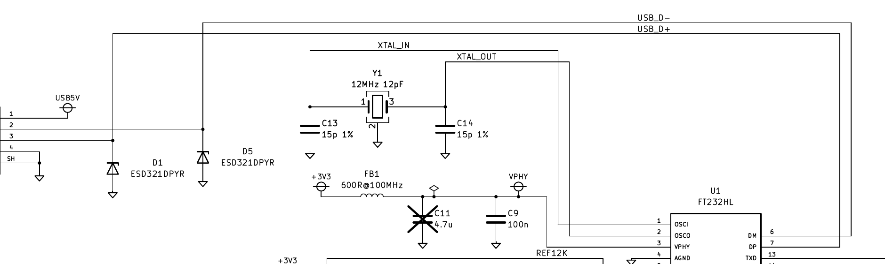
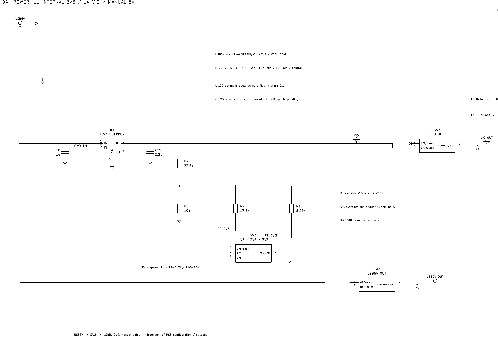

# R-0009〜R-0013 作図の一括調査

調査・記録は2026-11-22 20:27 JST、Codex。ユーザーの「一括調査お願い」に基づく。指摘日時は2026-11-22 20:11 JST。一括調査の依頼日時は未確認。

対象は`codex/a2-review-capacitors`、`886ad5428d4be98768ccc8bb942aa2f54f23d942`。回路図ソース、保存済みネットリスト、全体図と拡大図を照合した。設計は未変更。新規5件は調査中・未判定とし、以下の修正案への承認を待つ。R-0001〜R-0008のOK判定は維持する。

## 調査結果と対応案

| ID | 指摘要旨・調査結果 | 対応案 | 影響範囲・未確認事項 |
| --- | --- | --- | --- |
| R-0009 | C3はすでに縦向きだが、+3V3から24番ピン側の線を通り、右へ進んで上へ折れ、C3へ左戻りしている。給電経路と分岐点の関係が直感的でない | 12番ピン用の+3V3表示を分け、左から電源表示→C3上端の分岐点→12番ピンとする。C3は分岐点からGNDへ下向き。24番ピンとC4も同じ関係を保つ | C3/C4周辺の配線・電源表示・文字位置。C10のGND、REF、RESET周辺との間隔は修正後画像で確認 |
| R-0010 | USB5Vから40番ピンへの線がC1/C23の並列分岐より手前で上へ折れ、コンデンサが給電経路から下へ外れた枝に見える | USB5V→C1の分岐点→C23の分岐点→40番ピンの順に描き、両コンデンサを水平電源線からGNDへ縦配置する。C23をIC側にする | C1/C23・USB5V・40番ピン引込み。C7/C8やRESETとの重なりは局所移動で回避。電気的には並列のまま |
| R-0011 | 39番ピン付近のFLAGの縦線と配線の折上げが1.27mm重なる。重複した配線オブジェクトではなく、シンボル図形と配線の重なり | PWR_FLAGの接続点を折れ曲がりから水平直線部へ移す。FLAGの下から配線を上へ戻さず、接続点を明示する | #FLG07と局所配線・接続点のみ。+3V3への接続とERC上の宣言を維持 |
| R-0012 | 水晶はペア内2か所、USBは長距離折返し2か所とJ1近傍1か所の計3か所で交差。交差点に接続点はない | 水晶の折返し列の順番を整理し2→0か所。USBの上側経路と右側折返しの内外を整理し3→1か所。J1近傍の1か所は非接続交差として明確化 | 配線・ネット名の位置。DM/DP、OSCI/OSCOの接続先とD1/D5の短分岐を維持。候補経路の幾何確認のみで、修正後ネットリスト・ERCは未実施 |
| R-0013 | USB5V表示からU4入力線まで図面上67.31mmの縦間隔があり、U4とSW3も離れている。削除済み回路の位置を埋めず、説明文と長い供給線が大きな空白を残している | U4、C18/C19、R7〜R10、SW1を近接配置し、SW3を出力の直後へ寄せる。SW2は同じUSB5V分岐の近くへ移し、説明文・電源/GND/FLAGをまとめる | ブロック04内の配置・配線・注記・見出し線。隣接EEPROMや電源制御ブロックは原則維持。縮小率は配置後に評価 |

全件とも作図上の改善が必要と判断した。容量・型番・部品番号・フットプリント・既存部品の端子接続を変更する案ではない。電源表示を分ける場合も同じ+3V3ネットとする。回路図上の順序は接続意図の表示であり、電流のすべてがコンデンサを通る直列回路にはしない。

## R-0009・R-0010の詳細

C3の現在の経路は、+3V3表示が(108,86)、立上がりが(128,86)→(128,81)、C3分岐が(124,81)、12番ピンが(153,81)。座標は50milグリッド、1単位=1.27mmである。C3自体は縦向きだが、供給元から見て分岐点へ左に戻る。改善対象は向きだけでなく、供給元・分岐点・入力ピンの並び方である。

USB5V表示は(150,129)、C1/C23の分岐線はy=131。40番ピンへの経路は(150,129)から左へ進んだ後、x=146を上へ向かう。C1/C23はその手前の下枝に並ぶため、同じ問題がある。コンデンサ群を40番ピンへの引込み線の左へ寄せ、水平電源線上で分岐させる案とする。現在のC1/C23値とGND接続は維持する。

[現状の電源ピン拡大図](https://github.com/hebowiz/AI_PCB_design_test/blob/886ad5428d4be98768ccc8bb942aa2f54f23d942/01_New_Design/kicad_direct/reports/review_capacitors/after/power_pins.png)。保存済みネットリストではC3上端・U1.12/U1.24は+3V3、C1/C23上端・U1.40はUSB5V、各コンデンサ下端はGNDである。新規の電気的接続不良を確認したという指摘ではない。

## R-0011の重なり

#FLG07は(141,100)にあり、シンボル自身がy=99まで縦線を持つ。同じ位置に(141,100)→(141,99)の配線がある。したがって、FLAGの接続点が折れ曲がりの下端に置かれたことが、線の重なりの原因である。

水平な+3V3線の途中へFLAGを移せば、同じネットへの接続を保ちながら重なりを避けられる。FLAGを削除したりERC設定を変更したりする案ではない。

## R-0012の交差数と修正範囲

ソースの直交線分から、各ペア内部の交差を数えた。USBと水晶という二つのグループ間の交差数ではない。USBの長距離折返し交差は(74,29)、(187,65)。これにJ1近傍の(58,46)を加え、現状は3か所となる。水晶は(137,34)、(139,63)の2か所。

候補経路ではUSBの上側線と右側列の内外を入れ替え、水晶は右側の2列を入れ替える。端点を固定した座標案を解析し、USBの長距離部分と水晶の交差を0にできることを確認した。USBのJ1近傍1か所は残る。短いESD分岐と既存部品配置を維持する今回の案では、この1か所を明瞭な非接続交差として残すことを推奨する。USB全体で0交差となる配置の探索や、全周辺部品との干渉検証はまだ行っていない。

修正時はラベルと線の見かけの位置だけを入れ替えず、各信号の端子対応を維持する。幾何案の解析はネットリスト一致・ERCの代わりにはならない。

## R-0013の余白

現在のU4中心とSW3中心の横方向距離は184.15mm、U4中心とSW2中心の縦方向距離は77.47mm。いずれもA2図面上の距離で、PCBの寸法ではない。U3とU6を削除した版では、残る回路を全面再配置しなかったため、広い配線経路と空白が残っている。

ブロック内の実線接続を保ってU4周辺をまとめ、SW3をVIO出力側、SW2をUSB5Vの別分岐として近くに配置する。帰還抵抗とSW1の対応、C18/C19の入出力ピンとの対応、電圧切替と出力ON/OFFの違いを保つ。文字を小さくして詰める方法は採らない。独立したGNDのFLAGも余白に取り残さず、宣言として読める位置へ寄せる。

## 承認後の修正・検証案

承認された項目だけを、対象版から別の修正ブランチで作業する。回路図と今回用の補助スクリプト・レポートだけを変更し、PCB・BOM・Gerber・ライブラリ・既存生成スクリプトは保護する。

既存55実部品・193端子の接続、全ネット、部品属性、DNP、シンボル定義を変更前後で比較する。電源表示を追加・移動しても実部品の接続は完全に維持する。ERCは現在の設定で実行し、エラー・警告が増えないことを確認する。全体PDF/PNGと5項目の拡大図を出力し、給電経路、接続点、交差、文字間隔を再確認する。最終OK判定はユーザーが行う。

## 証跡と今回実施していないこと

[読取り専用の調査スクリプト](../evidence/R-0009_R-0013_inspect.py)、[座標・接続・交差の調査JSON](../evidence/R-0009_R-0013.json)。既存の回路図と保存済み出力用スナップショットはSHA-256 `798a6e5534fa6b08e183f11bb47539e9d9bb6a076d0c984c94935f08a8551478`で一致した。設計Worktreeはclean、対象コミットのままである。

今回の図は保存済みPNGの切出しであり、修正版の出力ではない。設計編集、再生成、ネットリスト再出力、ERC/DRCの再実行は行っていない。前回のERC0件という結果を、今回の修正案の検証済み結果として扱わない。日本語本文はyomiyasuで最終推敲した。
